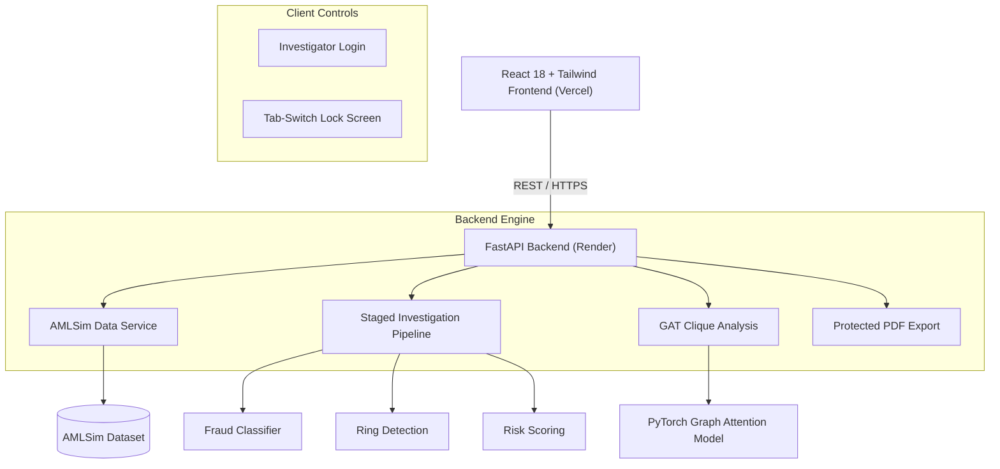

<div align="center">

# RING//BREAK

### Financial Fraud Ring Detection & Multi-Agent Forensic Platform

A graph-powered platform for detecting fraud rings, analyzing transaction networks, and running staged forensic investigations across large-scale financial data.

**[Live Demo](https://ringbreak-fraud-detection-six.vercel.app/)**

</div>

---

## Table of Contents

- [Overview](#overview)
- [Key Features](#key-features)
- [Tech Stack](#tech-stack)
- [System Architecture](#system-architecture)
- [Live Demo](#live-demo)
- [API Reference](#api-reference)
- [Getting Started](#getting-started)
- [Deployment](#deployment)
- [Author](#author)
- [License](#license)

---

## Overview

RING//BREAK is a financial crime investigation engine designed to detect, analyze, and disrupt coordinated fraud rings concealed within high-volume transaction data.

The platform is built on the synthetic **AMLSim** dataset. It combines a trained fraud classifier, graph analysis, and a **Graph Attention Network (GAT)** with a staged investigation pipeline. Together, they surface circular laundering loops, fan-in layering patterns, and repeat-offender networks.

| Dataset Metric | Value |
| :--- | :--- |
| Transactions | 117,533 |
| Account nodes | 1,000 |
| Alert clusters | 40 |

---

## Key Features

### Graph Attention Network

- **Structural clique detection:** A two-layer graph attention network, implemented in PyTorch, identifies tightly connected subgraphs and cyclic transaction loops.
- **Edge attention weights:** Learned attention weights highlight suspicious transaction corridors.
- **Fast graph indexing:** Transactions are pre-indexed by account, so neighbor lookups are dictionary hits instead of full scans of the 117k transactions.

### Staged Forensic Pipeline

Every transaction, whether injected from a scenario or taken from the AMLSim dataset, runs through the same sequence of stages. Each stage is recorded in an inspectable trace.

| Stage | Responsibility |
| :--- | :--- |
| **Ingestion** | Accepts and validates the transaction payload. |
| **Feature Engine** | Derives behavioural features such as amount, type and balance movement. |
| **ML Intelligence** | Scores fraud probability with a calibrated gradient-boosting classifier (scikit-learn). |
| **Graph Intelligence** | Builds the account/transaction network around the event. |
| **Ring Detection** | Looks for circular flows and coordinated alert-group patterns. |
| **Investigator Agents** | Behaviour, Network and Evidence agents produce findings from the earlier stages. |
| **Risk Assessment** | Combines model, graph and agent evidence into a 0-100 risk score. |
| **Response / Countermeasure** | Recommends holds, reviews or enhanced due diligence. Simulation only; no real action is taken. |
| **Report Generation** | Compiles the forensic report for export. |

### Investigator Controls

- **Investigator login screen:** The workspace sits behind a login gate.
- **Tab-switch lock screen:** The application locks when the investigator switches browser tabs, using the `visibilitychange` event.
- **Password-protected forensic reports:** Investigation summaries are exported as password-protected PDFs, with the investigation **Trace ID** as the password.

---

## Tech Stack

| Layer | Technology |
| :--- | :--- |
| Backend | Python 3.11, FastAPI, Uvicorn |
| Machine Learning | scikit-learn (fraud classifier), PyTorch (graph attention network), NetworkX |
| Frontend | React 18, TypeScript, Tailwind CSS, Vite |
| Data | AMLSim synthetic transaction dataset |
| Hosting | Render (backend), Vercel (frontend) |

---

## System Architecture



---

## Live Demo

**Deployed application:** [https://ringbreak-fraud-detection-six.vercel.app/](https://ringbreak-fraud-detection-six.vercel.app/)

> **Note:** The backend runs on Render's free tier, which sleeps after 15 minutes without traffic. The first request after a pause can take up to a minute while it wakes up. Subsequent requests are fast.

---

## API Reference

### Health

```http
GET /health
```

**Response `200 OK`**

```json
{
  "status": "ok"
}
```

### Dataset Status

```http
GET /amlsim/status
```

**Response `200 OK`**

```json
{
  "sourceDataset": "AMLSim",
  "mode": "LIVE",
  "datasetAvailable": true,
  "transactionCount": 117533,
  "accountCount": 1000,
  "alertGroupCount": 40,
  "backendReachable": true
}
```

### Fraud Ring Check

```http
GET /amlsim/ring-check/{transaction_id}
```

| Parameter | Type | Description |
| :--- | :--- | :--- |
| `transaction_id` | string | ID of the transaction to evaluate. |

**Response `200 OK`** (abridged)

```json
{
  "transactionId": "10253",
  "detected": true,
  "reason": "Alert group #12 cycle membership found.",
  "ring": {
    "ringId": "AMLSIM-ALERT-12",
    "confidence": 92,
    "members": ["793", "752", "783"],
    "memberCount": 3,
    "transactionVolume": 5,
    "amountInvolved": 10250.0,
    "currency": "USD"
  }
}
```

### Other Endpoints

| Method | Path | Purpose |
| :--- | :--- | :--- |
| `GET` | `/amlsim/transactions` | Paginated AMLSim transactions (`offset`, `limit`, `is_fraud`, `search`). |
| `GET` | `/amlsim/accounts` | Paginated AMLSim accounts. |
| `GET` | `/amlsim/alerts` | Alert rows from the dataset. |
| `GET` | `/amlsim/patterns` | Alert pattern clusters. |
| `GET` | `/amlsim/presets` | Curated benign and fraud sample transactions. |
| `GET` | `/amlsim/investigate/{transaction_id}` | Full investigation for a dataset transaction. |
| `GET` | `/gnn/cliques/{transaction_id}` | GAT prediction, clique and attention weights. |
| `GET` | `/scenarios` | Built-in demo scenarios. |
| `POST` | `/scenarios/{scenario_id}/investigate` | Run a scenario through the pipeline. |
| `POST` | `/transactions/inject` | Run a custom transaction payload through the pipeline. |
| `GET` | `/investigations/{id}/report` | Forensic report for an investigation. |
| `POST` | `/export-protected-pdf` | Generate a password-protected PDF report. |

---

## Getting Started

### Prerequisites

- Python 3.11
- Node.js 18+
- npm 9+

### 1. Backend

From the repository root:

```bash
cd backend

# Create and activate a virtual environment
python -m venv .venv
source .venv/bin/activate      # Windows: .venv\Scripts\activate

# Install dependencies
pip install -r requirements.txt

# Start the FastAPI server
uvicorn app.main:app --host 0.0.0.0 --port 8000
```

### 2. Frontend

```bash
cd ../frontend

# Point the frontend at your local backend
echo "VITE_API_BASE_URL=http://localhost:8000" > .env.local

# Install dependencies
npm install

# Start the Vite development server
npm run dev
```

Open <http://localhost:5173> in your browser.

---

## Deployment

The backend and frontend are deployed separately.

### Backend: Render (free tier)

| Setting | Value |
| :--- | :--- |
| Root directory | `backend` |
| Runtime | Python 3 |
| Build command | `pip install -r requirements.txt` |
| Start command | `uvicorn app.main:app --host 0.0.0.0 --port $PORT` |
| Health check path | `/health` |
| Instance type | Free |

Environment variables:

| Variable | Value |
| :--- | :--- |
| `PYTHON_VERSION` | A full 3.11 version, for example `3.11.9` |
| `RINGBREAK_CORS_ORIGINS` | The exact frontend origin, for example `https://ringbreak-fraud-detection-six.vercel.app` (no trailing slash; separate multiple origins with commas) |

### Frontend: Vercel

| Setting | Value |
| :--- | :--- |
| Root directory | `frontend` |
| Framework preset | Vite |
| Build command | `npm run build` |
| Output directory | `dist` |

Set the following environment variable **before** building, because Vite embeds it at build time:

```env
VITE_API_BASE_URL=https://ringbreak-backend.onrender.com
```

After changing it, redeploy the frontend so the new value is picked up.

### Free-tier behaviour

- **Cold starts:** the backend sleeps after 15 minutes idle and takes up to a minute to wake. Open `/health` shortly before a demo, or use an uptime pinger.
- **Ephemeral storage:** investigations created at runtime are not persisted across restarts or redeploys. The AMLSim dataset and the model ship with the repository.
- **Memory:** the free instance has 512 MB of RAM, so heavy, optional endpoints such as `/gnn/cliques/{transaction_id}` may be slow or unavailable on it.

---

## Author

**Chella Krishnan D**
[GitHub](https://github.com/iamkr07) · [LinkedIn](https://linkedin.com/in/chella-krishnan-d-a91172383)

---

## License

Released under the MIT License.